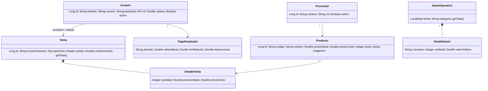

# Documentación técnica — Sistema de Gestión de Inventarios "El Punto"

## 1. Qué hace el sistema

Reemplaza el cuaderno de la papelería por una aplicación web. Resuelve el problema descrito en la problematización: el stock no se descontaba al vender, la caja no cuadraba y la información se perdía.

| Rol | Qué puede hacer | Archivo |
|---|---|---|
| Administrador | Ver resumen (dashboard), gestionar productos, proveedores, usuarios, pagos a empleados y gastos; ver y cancelar ventas. No vende. | `admin.html` |
| Vendedor | Ver inventario, vender en mostrador o a domicilio, imprimir factura. | `vendedor.html` |
| Cliente | Crear su perfil, ver productos con imagen y comprar (en tienda o domicilio). | `cliente.html` |

## 2. Arquitectura

Tres capas. El navegador nunca toca la base de datos: habla con la API REST y la API habla con MySQL.

```
Navegador (HTML/CSS/JS)  --JSON-->  Controladores (REST)  -->  Servicios  -->  Repositorios (JPA)  -->  MySQL
```

- **Controlador** (`controller/`): recibe la petición HTTP (`@GetMapping`, `@PostMapping`...) y devuelve JSON.
- **Servicio** (`service/`): reglas de negocio (descontar stock, calcular domicilio). Aquí vive lo importante.
- **Repositorio** (`repository/`): interfaces de Spring Data JPA; generan las consultas SQL solas.
- **Modelo** (`model/`): clases Java que representan las tablas (entidades).

## 3. Estructura de carpetas

```
papeleria-el-punto/
├── pom.xml                      Dependencias y versión de Java/Spring Boot
├── database/papeleria.sql       Crea la base de datos, las tablas y los datos de prueba
├── docs/DOCUMENTACION.md        Este documento
└── src/main
    ├── java/com/papeleria
    │   ├── PapeleriaApplication.java   Punto de arranque (main)
    │   ├── model/        Usuario, Proveedor, Producto, Venta, DetalleVenta, PagoEmpleado, GastoOperativo, DetalleGasto, HasId
    │   ├── repository/   Un repositorio por entidad principal
    │   ├── service/      VentaService (crear/cancelar ventas), DomicilioService (costo de envío)
    │   ├── controller/   CrudController (base), Producto/Proveedor/Usuario/Pago/Gasto, Venta, Auth, Domicilio, Dashboard
    │   ├── dto/          VentaRequest: forma del JSON que llega al registrar una venta
    │   └── config/       ManejadorErrores: convierte errores en {"mensaje": "..."}
    └── resources
        ├── application.properties      Conexión a MySQL y tarifas de domicilio
        └── static/                     Frontend (Spring lo sirve tal cual)
            ├── index.html              Login y registro de clientes
            ├── admin.html, vendedor.html, cliente.html
            ├── css/style.css           Estilos de todas las páginas
            └── js/common.js, admin.js, pos.js
```

### Qué hace cada archivo clave

- **`pom.xml`**: Maven lee este archivo y descarga Spring Web (API), Spring Data JPA (base de datos), el driver de MySQL y Lombok (genera getters/setters con `@Getter @Setter`).
- **`application.properties`**: datos de conexión. `ddl-auto=none` significa que Hibernate **no** modifica las tablas: la base se crea solo con el `.sql`.
- **`CrudController`**: clase abstracta con listar, obtener, crear, actualizar y eliminar. Productos, proveedores, usuarios, pagos y gastos solo la extienden y definen su ruta; así no se repite código.
- **`HasId`**: interfaz mínima para que `CrudController` pueda asignar el id y "desactivar" (en lugar de borrar) los registros que tienen campo `activo`.
- **`VentaService.crear`**: valida el carrito, comprueba stock, descuenta unidades, calcula domicilio, verifica el efectivo y guarda todo en **una sola transacción** (`@Transactional`): si algo falla, no queda nada a medias.
- **`common.js`**: funciones compartidas: `api()` para llamar al servidor, `sesion()` para proteger cada página por rol y `verFactura()` para la factura imprimible.
- **`admin.js`**: cada pestaña se describe en el objeto `TABS` (endpoint, columnas, campos del formulario). Una sola función dibuja todas. Para agregar una pestaña nueva basta añadir otro objeto.
- **`pos.js`**: punto de venta compartido por vendedor y cliente; el parámetro `rol` decide quién figura como vendedor o cliente en la factura.

## 4. Base de datos

Archivo: `database/papeleria.sql`. Ocho tablas:

| Tabla | Para qué sirve |
|---|---|
| `usuario` | Administradores, vendedores y clientes; el campo `rol` define la interfaz. |
| `proveedor` | Empresas que surten la mercancía. |
| `producto` | Inventario y catálogo (precio, costo, stock, imagen, proveedor). |
| `venta` | Encabezado de factura (quién, a quién, tipo, datos del domicilio). |
| `detalle_venta` | Líneas de cada factura; guarda precio y costo **de ese momento**. |
| `pago_empleado` | Nómina de vendedores. |
| `gasto_operativo` | Encabezado de gastos del negocio. |
| `detalle_gasto` | Líneas de cada gasto. |

Relaciones: `producto → proveedor` (muchos a uno); `venta → usuario` dos veces (vendedor y cliente, ambos opcionales: una compra en línea no tiene vendedor y una venta de mostrador no tiene cliente); `venta ← detalle_venta → producto`; `gasto_operativo ← detalle_gasto`; `pago_empleado → usuario`.

Reglas en la propia base: `CHECK` para stock y precios no negativos, `UNIQUE` en usuario, código de producto y número de factura.

## 5. API REST

Todas las rutas empiezan por `/api`.

| Método y ruta | Función |
|---|---|
| `POST /auth/login` | Valida usuario, contraseña y rol |
| `POST /auth/registro` | Un cliente crea su perfil |
| `GET/POST/PUT/DELETE /productos`, `/proveedores`, `/usuarios`, `/pagos`, `/gastos` | CRUD (`DELETE` desactiva si hay campo `activo`) |
| `GET /ventas` · `POST /ventas` · `PUT /ventas/{id}/cancelar` | Historial, nueva venta, cancelar y devolver stock |
| `GET /domicilio/costo?km=` | Costo del envío para una distancia |
| `GET /domicilio/costo-por-coordenadas?lat=&lon=` | Costo desde la papelería hasta unas coordenadas |
| `GET /dashboard` | Ingresos, ganancia, pagos, gastos, top 5 y stock bajo |

Ejemplo de venta:

```json
POST /api/ventas
{ "vendedorId": 2, "clienteId": null, "tipo": "DOMICILIO", "efectivo": 30000,
  "direccion": "Calle 5 #10-20", "telefono": "3001234567", "distanciaKm": 3.5,
  "items": [ { "productoId": 1, "cantidad": 2 }, { "productoId": 4, "cantidad": 1 } ] }
```

## 6. Cálculo del domicilio (cálculo integral)

- **Variable independiente:** distancia `d` en km (de la papelería, punto x, al destino, punto y). Parámetros fijos: tarifa base `b` y precio por km `p` (en `application.properties`).
- **Variable dependiente:** costo del domicilio `C`.

El costo es la tarifa base más lo acumulado a lo largo del recorrido, donde cada kilómetro aporta `p`:

```
C(d) = b + ∫₀ᵈ p dx = b + p·d
```

Con `b = 2000`, `p = 1500` y `d = 3,5 km`: `C = 2000 + 1500 × 3,5 = 7250`, que se redondea hacia arriba a la centena (**$7.300**). Si algún día el precio por km dependiera de la distancia, `p(x)` dejaría de ser constante y se integraría de verdad; hoy el resultado es la integral de una constante.

La distancia por coordenadas usa la fórmula de Haversine (línea recta sobre la esfera terrestre), por lo que es una aproximación de la ruta real.

**El servidor recalcula el costo siempre**; el botón "Calcular envío" del navegador solo muestra una vista previa. Así nadie puede alterar el precio desde el navegador.

## 7. Flujo de una venta

1. El vendedor o cliente agrega productos al carrito (solo en el navegador, sin tocar el stock).
2. Al confirmar, `pos.js` envía `POST /api/ventas`.
3. `VentaService` valida, descuenta el stock y guarda `venta` + `detalle_venta` en una transacción.
4. El servidor responde con la venta y el navegador muestra la factura.

Diferencia con la versión Java de escritorio: allá el stock se descontaba al agregar al carrito y había que devolverlo al quitar; aquí se descuenta una sola vez, al confirmar, lo que evita inconsistencias si se cierra la ventana.

## 8. Diagrama de clases (UML)



## 9. Historias de usuario → dónde se cumplen

| Historia | Implementación |
|---|---|
| RF001 Login por roles | `AuthController.login`, `index.html`, `sesion()` en `common.js` |
| RF002 CRUD de productos | `ProductoController`, pestaña Productos de `admin.js` |
| RF003 Venta por producto con total y cambio | `pos.js`, `VentaService.crear` |
| RF004 Descuento automático de stock | `VentaService.crear` (y `cancelar` lo devuelve) |
| RF005 Balance financiero | `DashboardController` |
| RF006 Ver inventario completo | Tabla de `vendedor.html` y `cliente.html`, pestaña Productos |
| RF007 Crear perfiles | Pestaña Usuarios (admin) y `AuthController.registro` (cliente) |
| RF008 Interfaces gráficas | Las cuatro páginas HTML |
| RF009 Persistencia | MySQL (reemplaza los archivos planos) |
| Extras | Domicilio, pagos, gastos, proveedores e imágenes de producto |

## 10. Limitaciones conocidas (mejoras para la siguiente etapa)

- **Contraseñas en texto plano.** Es aceptable para una demo académica, pero en producción deben guardarse con BCrypt (Spring Security).
- **Sin autenticación en la API.** Las páginas se protegen por rol en el navegador, pero un usuario técnico podría llamar a la API directamente. La solución real es Spring Security con sesiones o JWT.
- **Dinero como `Double`.** Para un sistema contable real conviene `BigDecimal`.
- **Dos ventas simultáneas del mismo producto** podrían competir por el último stock; se resuelve con bloqueo optimista (`@Version`).
- **No se probó contra tu MySQL.** El código se escribió sin compilarlo en un entorno con Maven; la primera ejecución puede mostrar algún error menor de dependencias o conexión que habrá que ajustar.

## Mejoras de la versión actualizada

- El panel de administración incorpora la sección **Reportes de ventas**, con filtros por fecha y estado, totales del periodo, ganancia bruta estimada y exportación CSV compatible con Excel.
- En el formulario de productos se pueden reutilizar categorías existentes mediante sugerencias o escribir una nueva categoría.
- El punto de venta permite asociar una venta a un cliente registrado; también se puede mantener como venta de mostrador sin cliente asignado.
- La interfaz del selector de cliente y de los filtros de reportes se adapta a pantallas pequeñas.

**Nota sobre permisos:** el inicio de sesión y la navegación de pantallas existentes distinguen los roles en la interfaz. Antes de exponer el sistema a internet o usarlo con información real, debe añadirse autenticación y autorización en el servidor para proteger también los endpoints de la API; ocultar pantallas en el navegador por sí solo no es una barrera de seguridad.
